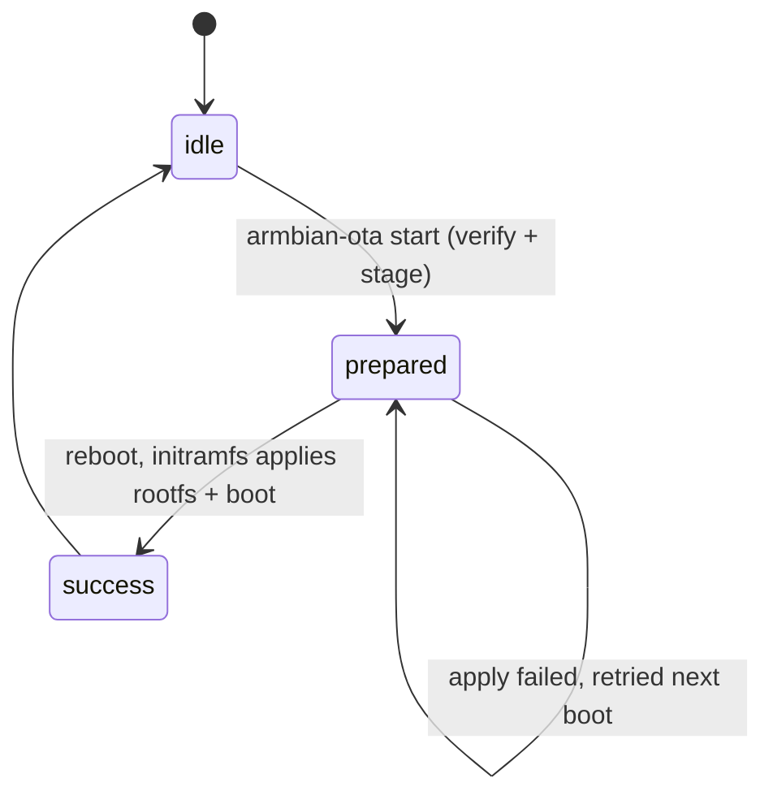
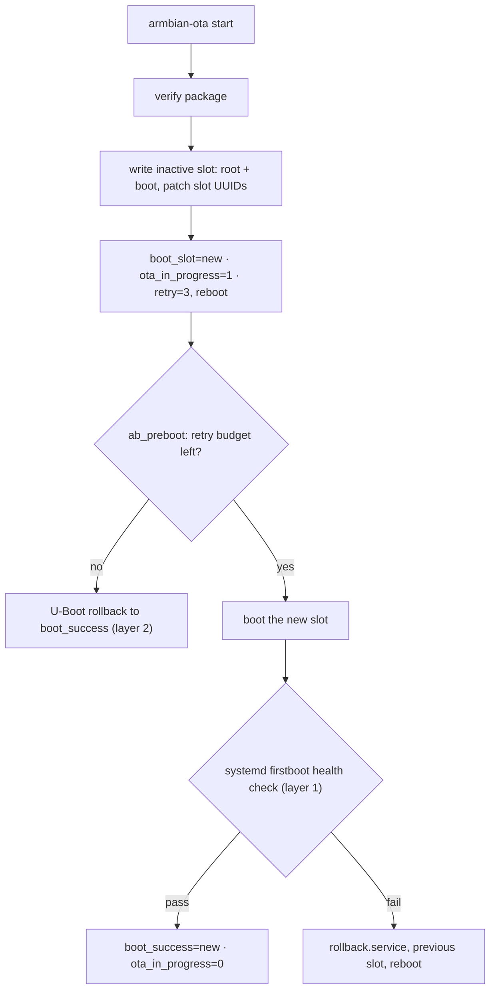

# Armbian OTA Support

This extension provides two OTA (Over-The-Air) update mechanisms for Armbian:

1. **Recovery OTA** — single-system update staged on userdata and applied by the initramfs on the next boot
2. **A/B Partition OTA** — dual-slot update written to the inactive slot with health checks and automatic rollback

Both modes share one CLI, one package format, and one partition-size policy. They combine freely with the encryption tiers (plain / OP-TEE auto-decrypt / secure boot); see `docs/` for the encryption side. This file is the developer-oriented internals reference; step-by-step usage lives in `docs/03-ota-recovery.md` and `docs/04-ota-ab.md`.

Note: When `OTA_ENABLE=yes`, OTA runtime is installed into the firmware by mode:
- `AB_PART_OTA=yes`: install AB OTA runtime/tools.
- without `AB_PART_OTA`: install Recovery OTA runtime/tools.

## How OTA Works

One principle, two strategies.

**Principle — updates never touch user data.** The firmware rootfs is
mounted read-only under overlayroot; every runtime write (installed
packages, `/home`, `/var/lib`) lands on the writable `userdata`
partition, which no update path rewrites. An update replaces only the
read-only base, so `userdata` carries your data across every update in
both modes (details: `docs/03-ota-recovery.md` §2).

| | Recovery | A/B |
|---|---|---|
| Systems on disk | one | two complete slots |
| Update written to | userdata staging area | the inactive slot, while the device keeps running |
| Applied by | initramfs hook, at next boot | runtime backend, before reboot |
| Failure handling | retried on every boot until it succeeds (no counter) | health check + automatic rollback, two layers |
| Cost | minimal disk | ~2× boot/rootfs space |

### Recovery lifecycle

State lives in `userdata/ota-recovery/state/ota-state.env` — written by
`armbian-ota start`, validated and advanced by the initramfs hook:



There is **no rollback** in Recovery mode: the old rootfs is overwritten
by the (verified) new one, and a failed apply is retried forever, not
reverted — bounded retries and rollback are A/B-only.

### A/B lifecycle and the two rollback layers

The U-Boot environment — not Linux — is the source of truth
(`boot_slot`, `boot_success`, `ota_in_progress`, `slot_retry_left`):



Layer 1 (systemd health check) catches a slot that boots but is
unhealthy; layer 2 (U-Boot retry counter) catches a slot that never
reaches systemd. Together they make a bad update unable to brick an
A/B device.

### Where the state lives

| Mode | State | Written by |
|---|---|---|
| Recovery | `userdata/ota-recovery/state/ota-state.env` (`STATUS=idle/prepared/success`) + staged payload | runtime `start`, initramfs apply |
| A/B | per-slot `/var/lib/armbian-ota/ota-state.env` + persistent U-Boot env at raw offset `0x3f8000` | runtime `start`, firstboot units, `ab_preboot` |

### Boot-disk anchoring

Every device lookup — root, boot, security, userdata — is anchored to the
disk U-Boot actually loaded the boot payload from, identified by the
`armbian.bootdev` / `armbian.bootdevnum` kernel cmdline tokens. In the
initramfs,
[`armbian-bootdev-root`](../initramfs/scripts/init-top/armbian-bootdev-root)
rewrites the `root=` resolution to that disk (via `/conf/param.conf`,
leaving single-disk boots untouched). Identical cloned images attached as
additional disks therefore cannot capture the boot, the LUKS unlock, or
the update.

## Directory Structure

```text
armbian-ota/
├── ota-support.sh                          # Main build hook entry point
├── common/                                 # Shared OTA functionality
│   ├── build-hooks/
│   │   ├── image-naming.sh                 # Image/package naming helpers
│   │   ├── ota-payload-security.sh         # Encrypted payload pubkey install
│   │   ├── overlayroot.sh                  # overlayroot setup (recurse=0)
│   │   ├── package-create.sh               # OTA package creation + payload encryption
│   │   ├── partitions.sh                   # Shared partition primitives + size policy
│   │   ├── rootfs-install.sh               # Rootfs rsync helper
│   │   ├── uboot-default-env.sh            # Extract U-Boot compiled default env
│   │   ├── uboot-env-prefill.sh            # Write persistent env at 0x3f8000 (build time)
│   │   └── userdata-resize.sh              # Shared userdata resize service install
│   └── rootfs/                             # armbian-ota CLI, shared libs, resize service
│       └── usr/sbin/armbian-ota
│
├── recovery/                               # Recovery OTA mode
│   ├── build-hooks/
│   │   ├── partitions.sh                   # Recovery boot/[security]/rootfs/userdata layout
│   │   └── runtime-install.sh              # Recovery rootfs and initramfs setup
│   ├── initramfs/                           # 99-ota-apply hook + recovery/{log,device,payload}.sh
│   └── rootfs/usr/share/armbian-ota/recovery/
│                                               # Recovery backend
│
└── ab/                                     # A/B partition OTA mode
    ├── build-hooks/
    │   ├── partitions.sh                   # boot_a/boot_b/[security]/rootfs_a/rootfs_b/userdata
    │   └── runtime-install.sh              # A/B rootfs and services setup
    └── rootfs/
        ├── etc/systemd/system/             # firstboot / rollback / init-uboot units
        ├── etc/u-boot-initial-env          # A/B initial environment template
        └── usr/
            ├── lib/armbian/                # health-check, init-uboot executables
            └── share/armbian-ota/ab/       # A/B backend, env, partitions, security libs
```

The build hooks install `common/rootfs` first, then install the selected mode overlay with `rsync`. Files under each `rootfs/` directory therefore mirror their final paths in the image.

## The `armbian-ota` CLI

```bash
armbian-ota start <ota-package.tar.gz>   # root required
armbian-ota status                       # no root required
armbian-ota switch-slot [a|b]            # A/B firmware only, root required
```

- `start` takes exactly one argument (the package path) and rejects any `-` option. The update mode is **not** selectable on the command line: it is read from the package's `package.env` (`OTA_MODE=ab|recovery`) and cross-checked against the mode backend installed on the firmware.
- `start` also compares `OTA_ENCRYPTED` from `package.env` against the device's actual encryption state (A/B probes the boot-disk-anchored `rootfs_a`/`rootfs_b` for `crypto_LUKS`; Recovery answers from the running root filesystem) and aborts on mismatch — an encrypted package never applies to a plain device and vice versa.
- `switch-slot` with no argument switches to the other slot; with `a`/`b` it targets that slot. It refuses to run while an OTA is in progress. It only rewrites the U-Boot environment — **reboot manually to apply**.
- `mark-success` and `rollback` are internal actions driven by the A/B first-boot systemd units; avoid running them by hand.

## Recovery OTA Mode

### Configuration

Set these environment variables to enable Recovery OTA:

```bash
OTA_ENABLE=yes
# Do not set AB_PART_OTA
```

### Partition Layout

GPT partition table, located by partition labels. Order: `[boot][recovery?][security?][rootfs][userdata]`.

| Partition | PARTLABEL / fs label | Purpose |
|-----------|-------|---------|
| p1 | `boot` / `armbi_boot` | `/boot` files (ext4, plain and auto-decrypt) or raw FIT image (secure boot) |
| p2 (secure boot) | `recovery` | raw FIT rescue partition — same signed boot.itb, booted by `ota_rescue_boot_fit` (vendor `boot_fit`); never touched by OTA |
| p2/p3 (encrypted modes) | `security` | crypto key material, no filesystem |
| following | `rootfs` / `armbi_root` | rootfs (LUKS+ext4 in auto-decrypt mode) |
| last | `userdata` / `armbi_usrdata` | overlayfs upper layer + OTA transaction store |

Plain recovery:
```
[ boot ext4 ][ rootfs ext4 ][ userdata ext4 ]
```

Auto-decrypt recovery (RK_OPTEE_BOOT_ENABLE=yes):
```
[ boot ext4 ][ security ][ rootfs LUKS+ext4 ][ userdata LUKS+ext4 ]
```

Secure boot recovery (RK_SECURE_UBOOT_ENABLE=yes, BOOT_RAW_MODE=yes):
```
[ boot raw FIT ][ recovery raw FIT ][ security ][ rootfs LUKS+ext4 ][ userdata LUKS+ext4 ]
```

The `/boot` partition is **never** overlayed. The initramfs mounts it on top of overlayfs (`zz-seeed-mount-boot`, anchored to the rootfs disk; there is no `/boot` fstab entry), so any process writing to `/boot` (apt kernel upgrades, manual `armbianEnv.txt` edits, OTA tooling) hits the real boot partition — U-Boot reads the same bytes on next boot. `overlayroot` runs with `recurse=0` so the overlay covers `/` only and leaves the boot mount as a direct mount.

### How It Works

1. `armbian-ota start` verifies the package (sha256; on encrypted builds: RSA-PSS manifest signature, AES-256-CBC decryption, digest re-check), extracts it to `userdata/ota-recovery/ota_work/`, and writes `OTA_MODE=recovery STATUS=prepared` into the on-userdata state file. Recovery mode uses no fw_env flags.
2. On reboot the initramfs OTA hook (`scripts/init-premount/99-ota-apply`) runs:
   - Detects devices, anchoring all lookups to the actual U-Boot boot disk (via the `armbian.bootdev`/`armbian.bootdevnum` cmdline tokens injected by the build-time env prefill). Cloned or foreign disks attached to the system cannot capture the update.
   - On encrypted builds, unlocks rootfs (`/dev/mapper/armbian-root`) and userdata (`armbian-userdata`).
   - Validates the staged state (`STATUS=prepared`, payload present; re-verifies the manifest digest if present).
   - Applies the new rootfs with a single `tar -xzf` onto the root device, then applies the boot payload if present (`boot.tar.gz` unpacked on the mounted boot partition; `boot.itb` on secure boot dd-ed to the raw boot partition after PARTNAME, FIT-magic and size checks — a boot.itb failure aborts the OTA).
   - Patches `armbianEnv.txt` (`rootdev`, `cryptdevice`), fstab/crypttab UUIDs and merges overlays; removes the staging directory; writes `STATUS=success`; reboots.
3. On any failure the hook exits 0 and boots the old system; the staged payload stays and is retried on every subsequent boot until it succeeds (there is no retry counter in Recovery mode — bounded retries are an A/B-only mechanism).
4. A separate userdata partition supplies the persistent overlay upper layer; user data written at runtime survives the update.

Logs land in `/run/initramfs/ota.log` (carried into the running system via `/run`).

### Rescue (the independent recovery environment)

Every recovery image carries a rescue boot path that never depends on the
rootfs; U-Boot routes to it through the transactional `bootcmd` whenever
`ota_in_progress=1` or a normal boot falls through. Two flavors share one
dispatcher (`ota_rescue_boot=run ota_rescue_boot_fs || run ota_rescue_boot_fit
|| run distro_bootcmd`):

- **ext4 layouts** (`ota_rescue_boot_fs`): `Image` + `uInitrd` + `board.dtb`
  in `boot/recovery/`, loaded with `ext4load` and started with `booti`.
- **raw-FIT/secure layouts** (`ota_rescue_boot_fit`): the same **signed
  boot.itb** flashed to the dedicated `PARTLABEL=recovery` partition at image
  build time, booted with the vendor `boot_fit` command (`boot_fit_part
  recovery`) — FIT signature verification applies, and the FIT's ramdisk is
  the same-build initramfs, so the rescue boots straight into the
  `99-ota-apply` Rescue role (`armbian.ota_role=recovery`).

The rescue set is **never updated by OTA** (packages stage the boot
partition with `recovery/` excluded and never touch the recovery partition),
so a bad update can never destroy its own rescuer.

### Usage

```bash
# On target system
armbian-ota start Armbian_xxx_OTA.tar.zst
reboot
```

## AB Partition OTA Mode

### Configuration

Set these environment variables to enable AB Partition OTA:

```bash
OTA_ENABLE=yes
AB_PART_OTA=yes
```

**Important**: AB OTA and Recovery OTA are mutually exclusive. You cannot enable both at the same time.

### Partition Layout

GPT partition table. Order: `[boot_a][boot_b][security?][rootfs_a][rootfs_b][userdata]`. Boot is two independent per-slot partitions (not shared); the security partition, when present, is shared.

| Partition | PARTLABEL | fs label | Purpose |
|-----------|-----------|----------|---------|
| p1 | `boot_a` | `armbi_boota` | Boot slot A (ext4; raw FIT partition on secure boot) |
| p2 | `boot_b` | `armbi_bootb` | Boot slot B |
| p3 (encrypted) | `security` | — | Shared key material |
| p4/p5 | `rootfs_a` / `rootfs_b` | `armbi_roota` / `armbi_rootb` | Root slots (LUKS+ext4 when encrypted) |
| last | `userdata` | `armbi_usrdata` | Shared writable data (LUKS+ext4 when encrypted) |

Plain A/B:
```
[ boot_a ext4 ][ boot_b ext4 ][ rootfs_a ext4 ][ rootfs_b ext4 ][ userdata ext4 ]
```

Encrypted A/B (auto-decrypt or secure boot):
```
[ boot_a FIT* ][ boot_b FIT* ][ security ][ rootfs_a LUKS+ext4 ][ rootfs_b LUKS+ext4 ][ userdata LUKS+ext4 ]
```
\* raw FIT partitions only in secure boot (`BOOT_RAW_MODE`); otherwise ext4 like plain.

### U-Boot Environment Variables

The persistent U-Boot environment lives at raw offset `0x3f8000` (size `0x8000`) on the boot disk, pre-filled at build time (`uboot-env-prefill.sh`) and completed on first boot by `armbian-ota-init-uboot`.

| Variable | Purpose |
|----------|---------|
| `boot_slot` | Slot to boot on next reset (a or b) |
| `boot_success` | Last slot that passed health checks |
| `ota_in_progress` | 1 while an update is pending verification |
| `slot_retry_max` / `slot_retry_left` | Boot-attempt budget for the pending slot (default 3) |
| `ab_boot_mode` | `filesystem` or `raw-fit` (raw-fit injected at build time for secure-boot FIT boot) |
| `ab_boot_devtype` / `ab_boot_devnum` | Boot device type/number for slot selection |
| `distro_bootpart_a` / `distro_bootpart_b` | Boot partition numbers per slot |
| `ab_preboot` | Pre-boot script: decrements `slot_retry_left`, rolls back to `boot_success` when exhausted |

### How It Works

1. `armbian-ota start` verifies the package, then writes the full payload to the **inactive** slot:
   - Root: opens the inactive rootfs partition (on encrypted builds with `cryptsetup luksOpen` using the same passphrase — the LUKS header is not reformatted), clears it, and extracts `rootfs.tar.gz`; writes the per-slot `ota-state.env`.
   - Boot: on secure boot, verifies and dd-writes `boot.itb` to the inactive raw boot partition; otherwise unpacks `boot.tar.gz` onto the inactive ext4 boot partition. `armbianEnv.txt` rootdev/cryptdevice, overlay lists, and fstab/crypttab are patched for the target slot.
2. Switches the slot: `ota_in_progress=1`, `boot_slot=<target>`, `slot_retry_left=slot_retry_max`, then asks for a reboot.
3. On the next boots, `ab_preboot` decrements `slot_retry_left`; `armbian-ota-firstboot.service` (guarded on `ota_in_progress=1`) runs `armbian-ota-health-check`: correct slot active, `/proc/version` readable, `/proc` `/sys` `/dev` mounted, root writable.
4. Success → `mark-success` (writes `boot_success=<slot>`, clears `ota_in_progress`). Failure → `OnFailure=` pulls in `armbian-ota-rollback.service`, which restores the previous slot and reboots. If the system is too broken to reach systemd, `ab_preboot` exhausts `slot_retry_left` (3 attempts) and U-Boot itself rolls back to `boot_success` — rollback works at two independent layers.

### Usage

```bash
# Check status
armbian-ota status

# Start OTA update, then reboot
armbian-ota start Armbian_xxx_AB_PART.tar.gz
reboot

# Manually switch slots after an OTA has completed (reboot to apply)
armbian-ota switch-slot a      # or: armbian-ota switch-slot b
```

## Build Configuration

Add to your board configuration or build command (identical policy for both modes):

```bash
OTA_ENABLE=yes
AB_PART_OTA=yes              # A/B only; leave unset for Recovery
OTA_BOOT_SIZE=512            # Boot partition(s) in MiB (default 512, per slot for A/B)
OTA_SECURITY_SIZE=4          # Security partition in MiB (encrypted images, default 4)
# OTA_ROOTFS_SIZE=4096       # Optional rootfs partition size override (per slot for A/B)
OTA_USERDATA_SIZE=512        # Userdata partition in MiB (default 512, grows to full disk on first boot)
```

When unset, `OTA_ROOTFS_SIZE` is calculated from the built rootfs size plus `EXTRA_ROOTFS_MIB_SIZE`, then adds 20% headroom.

Both OTA modes require a GPT partition table. Their boot, rootfs, userdata, and security partitions are located by GPT partition labels. Both OTA layouts boot through U-Boot and do not include BIOS or UEFI partitions.

### Initial U-Boot environment

At build time `uboot-default-env.sh` extracts U-Boot's compiled default environment from the ELF and merges it with `ab/rootfs/etc/u-boot-initial-env` into the image's `/etc/u-boot-initial-env` (rootfs template wins on conflicts); `uboot-env-prefill.sh` writes the resulting persistent environment to raw offset `0x3f8000`. On first boot `armbian-ota-init-uboot` repairs missing defaults, writes `/etc/fw_env.config`, and fills in `distro_bootpart_a/b`, `ab_boot_devtype/devnum`, and `ab_boot_mode` (auto-detecting `raw-fit` when no boot partition carries a filesystem). This keeps `distro_bootcmd`/`scan_dev_for_boot` intact while the slot logic overlays them.

## OTA Package Contents

The OTA package (`*_OTA.tar.gz` / `*_OTA.tar.xz` / `*_OTA.tar.zst` — outer codec follows the build default, zstd for plain recovery and xz for A/B; A/B adds an `_AB_PART` marker, Recovery uses stock image names — the mode lives in `package.env`) contains:

- `rootfs.tar.gz` + `rootfs.sha256` — root filesystem payload (required)
- `boot.tar.gz` + `boot.sha256` — boot partition payload (plain/auto-decrypt with separate boot partition)
- `boot.itb` — signed FIT boot image (secure boot), written directly to the raw boot partition; mutually exclusive with `boot.tar.gz`
- `package.env` — `OTA_MODE` (ab|recovery), `OTA_ENCRYPTED`, `BOARD`, `RELEASE`, `BRANCH`, `VERSION`, `KERNEL`
- `version.txt` — original image name, version, vendor, board, release, branch, kernel, build commit, extension commit
- `<image>_OTA.checksums` — written next to the package (not inside): MD5 + SHA256 of the tarball
- Encrypted builds additionally: `rootfs.tar.gz.enc` (AES-256-CBC; key = HKDF-SHA256 of the LUKS passphrase, info `armbian-ota-payload-v1`), `payload.manifest` (cipher, IV, plaintext sha256), `payload.manifest.sig` (RSA-PSS/SHA256 signature under the secure-boot FIT key; the public key is installed at `/usr/share/armbian-ota/keys/ota-payload.pub.pem` at build time)

The package does not include an offline `ota_tools/` bundle; the required OTA runtime is installed into the firmware at image build time.

## Persistent Data

User account database files (`/etc/passwd`, `/etc/shadow`, `/etc/group`, `/etc/gshadow`, `/etc/subuid`, `/etc/subgid`) remain normal files in the overlay filesystem. This is required because tools such as `useradd` and `groupadd` update those files by writing a temporary file and renaming it over the original.

Both OTA modes use overlayroot with the final `userdata` partition as the writable upper layer (`recurse=0`, overlay on `/` only). Runtime writes — including `/home` and `/var/lib` — persist on `armbi_usrdata` without changing the OTA rootfs. Encrypted A/B and Recovery images use the initramfs-unlocked `/dev/mapper/armbian-userdata` mapper as the overlayroot backing device.

In Recovery mode the dedicated `/boot` partition is the one exception to overlayfs (see above). Recovery OTA stores its pending payload and state in `userdata/ota-recovery/`; the initramfs rewrites only the raw rootfs lower layer and leaves userdata intact.

Neither OTA mode migrates data from older single-rootfs Recovery images; this layout is intended for new development images.

On first boot, `armbian-resize-userdata.service` expands the final `userdata` partition to use available disk space in both modes (partition must be last on disk; shrink is refused). For encrypted images the resize is two-step: the first boot grows the partition and logs that a reboot is required; the next boot reopens the `armbian-userdata` LUKS mapper at the new size and grows the inner ext4.

## Troubleshooting

### Check OTA Status

```bash
armbian-ota status
```

### View Logs

```bash
# OTA manager / health check (runtime)
cat /var/log/armbian-ota/ota.log

# Initramfs apply log (Recovery), carried into the running system via /run
cat /run/initramfs/ota.log
```

### Automatic Rollback (A/B)

Rollback runs at two layers: `armbian-ota-rollback.service` fires when the first-boot health check fails, and the U-Boot `ab_preboot` script rolls back to `boot_success` after `slot_retry_left` (default 3) consecutive failed boot attempts even if systemd never starts. Use `armbian-ota switch-slot [a|b]` for manual slot maintenance after an OTA has completed.

### Check / Set U-Boot Environment (A/B)

```bash
fw_printenv -n boot_slot
fw_printenv -n ota_in_progress
fw_printenv -n slot_retry_left

fw_setenv boot_slot a
fw_setenv boot_success a
fw_setenv ota_in_progress 0
```

### Package / device encryption mismatch

`armbian-ota start` refuses a package whose `OTA_ENCRYPTED` disagrees with the device state. This is intentional: flash the matching firmware tier, or rebuild the package for the target tier.

### Multi-disk systems

All OTA device lookups (root, boot, security, userdata) are anchored to the actual U-Boot boot disk via the `armbian.bootdev`/`armbian.bootdevnum` cmdline tokens. A cloned disk attached as a second device does not redirect updates. If OTA cannot find an expected partition, verify it is on the boot disk: `ls -l /dev/disk/by-partlabel/`.

## Development

### Adding New Features

1. For Recovery OTA: modify files in `recovery/rootfs/`, `recovery/initramfs/`, or `recovery/build-hooks/`
2. For AB OTA: modify files in `ab/rootfs/` or `ab/build-hooks/`
3. For shared functionality: use `common/rootfs/` or `common/build-hooks/`

### Build Hook Entry Points

In `ota-support.sh` and `*/build-hooks/*.sh` (ordering matters):

- U-Boot default env packaging: `post_uboot_custom_postprocess__890_*` (`common/build-hooks/uboot-default-env.sh`)
- overlayroot configuration: `pre_update_initramfs__892_*` (`common/build-hooks/overlayroot.sh`)
- Recovery initramfs hooks: `pre_update_initramfs__894_*` (`recovery/build-hooks/runtime-install.sh`)
- A/B runtime + merged initial env: `pre_update_initramfs__895_*` (`ab/build-hooks/runtime-install.sh`)
- Resize userdata service: `pre_umount_final_image__896_*` (`common/build-hooks/userdata-resize.sh`)
- OTA payload pubkey install: `pre_umount_final_image__897_*` (`common/build-hooks/ota-payload-security.sh`)
- OTA package creation (incl. payload encryption): `pre_umount_final_image__901_*` (`common/build-hooks/package-create.sh`)
- Persistent U-Boot env prefill at 0x3f8000: `post_write_uboot_platform__910_*` (`common/build-hooks/uboot-env-prefill.sh`)

## License

This extension is part of the Armbian project and follows the same license.
